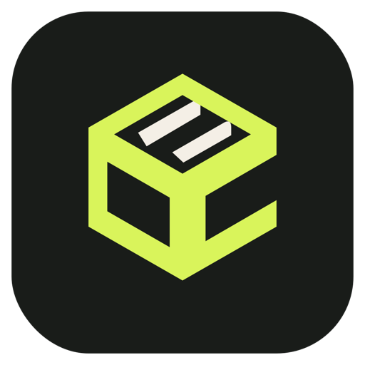

# Crate

Crate is a free Mac app for DJs. It analyses your music beyond BPM and key (energy, mood, vocals and more), helps you find new music, and builds playlists and sets that mix well, then publishes them to Apple Music so they sync to your devices and show up in Traktor and djay.

Website: https://crate-music-app.vercel.app

This repository holds the downloads and install notes. Get the app from the [latest release](../../releases/latest).

## Requirements

- A Mac with Apple silicon (M1 or later), macOS 13 or newer
- The Apple Music app, with your DJ tracks in its library as files on your Mac
- About 1 GB of free disk space for the app (the download is about 270 MB), plus room for analysis data and backups of your Apple Music library
- An internet connection the first time you run it (see below)
- Optional: an [Anthropic API key](https://console.anthropic.com) for Discover and chat-based playlist building. Everything else works without one.

## Install

1. Download `Crate.dmg` from the [latest release](../../releases/latest).
2. Open it and drag **Crate** into **Applications**.
3. The first launch needs one extra step, because Crate isn't signed with an Apple Developer ID yet. Double-click Crate and macOS will say "Apple could not verify Crate is free of malware". Click **Done** (not Move to Bin), then either:
   - Open **System Settings → Privacy & Security**, scroll down to the Security section, find the message that Crate was blocked, click **Open Anyway**, and enter your password. The button only appears after you've tried to open Crate, and for about an hour afterwards. (On macOS 15 and later, right-click → Open no longer works.)
   - Or in Terminal, which skips the warning: `xattr -dr com.apple.quarantine /Applications/Crate.app`

You only need to do this once.

## First launch

**Apple Music permission.** Crate reads your Apple Music library and publishes playlists to it, so macOS asks whether Crate may control **Music**. Click **OK**. If you declined by mistake, switch it on in **System Settings → Privacy & Security → Automation → Crate → Music**. Without it, Crate can't import or publish.

**Analysis models.** The first time you analyse tracks, Crate downloads its analysis models (about 35 MB) from the [Music Technology Group at Universitat Pompeu Fabra](https://essentia.upf.edu/models.html). This happens once.

**Anthropic key (optional).** In **Settings**, paste a key to turn on Discover and chat playlist building. It's stored in your macOS Keychain. Discover and chat send your written brief, and in Discover's case web searches, to Anthropic. Your audio is not sent anywhere.

## What it does

1. **Import** tracks from your Apple Music library.
2. **Analyse** them on your Mac: tempo, key (Open Key, as in Traktor), energy, mood, vocals, instruments and a Crate genre.
3. **Review** the least certain results and correct them.
4. **Discover** new songs to buy for an event, with previews and buy links.
5. **Build** playlists (a pool of tracks to choose from live) or full sets with every transition planned.
6. **Publish** to Apple Music. Crate only creates and changes playlists in its own folders (Crate Sets, Crate Playlists, Crate).

## Your library is safe

- Crate never edits, converts or moves your audio files.
- Before any write to Apple Music it backs up your library to `~/Music/Crate Backups`, and every change can be undone from the **Changes** screen.
- Writing tags to track Comments (so tags show in Traktor) is optional, and any text you already have there is kept.

## Where Crate keeps its data

`~/Library/Application Support/Crate`. To uninstall, drag Crate from Applications to the Bin and delete that folder. Playlists Crate published stay in Apple Music until you delete them. They live in the Crate Sets, Crate Playlists and Crate folders.

## Licence

Crate is free for non-commercial use. See [LICENSE.md](LICENSE.md) for what that rests on.

## Feedback

This is an early release shared by its author. Issues are turned off here, so for feedback, contact the person who shared it with you.
